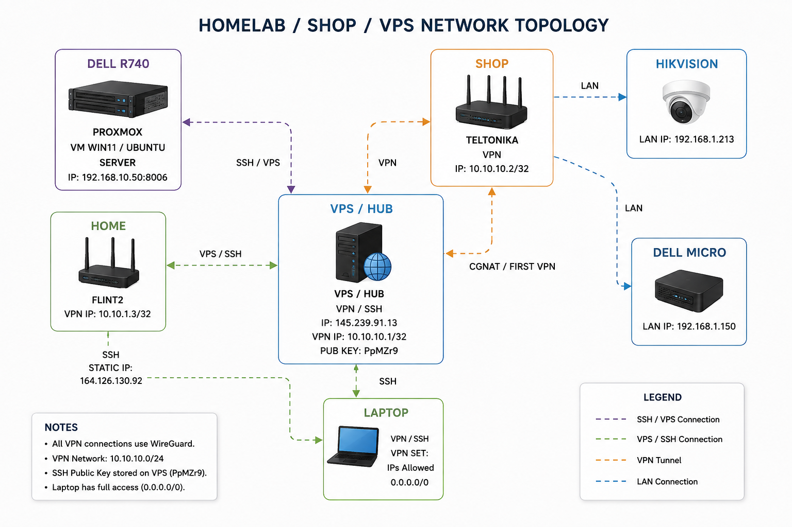
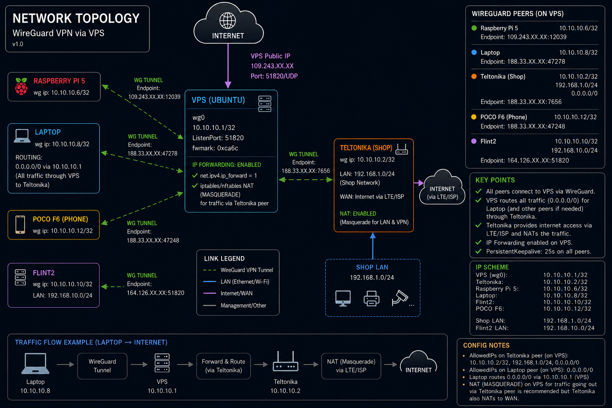

# HomeLab Projects

This repository documents practical infrastructure projects built,
tested, troubleshot, and documented in my personal HomeLab.

My focus is on understanding how systems work together through real
implementations and troubleshooting rather than only following tutorials.

## Infrastructure Diagram

## Network Topology

## Hardware Overview

### Server
- Dell PowerEdge R740
- Proxmox VE
- RAID storage
- iDRAC Enterprise

### Laptop
- Dell Latitude 7490
- Ubuntu 24.04 LTS

### Routers
- GL.iNet Flint 2
- Teltonika RUT955

### Single-board computer
- Raspberry Pi 5
- Ubuntu Server

### Network devices
- Dell Micro PC
- IP Camera
- Smart Plug

### Virtual Machines
- Ubuntu Server
- Ubuntu Desktop
- Windows Server
- Windows 11

### Projects

This section summarizes the technologies I have explored, the practical skills I have developed, and the areas I am currently improving through my HomeLab.

Everything in this repository has been built, configured, tested and documented in my own homelab. My focus is understanding how technologies work together rather than simply following tutorials.

1. Android Remote Management

### Android Remote Management

**Project description:**  
Built an automated workflow for connecting a laptop to a Poco F6 over a dedicated Wi-Fi hotspot. The setup uses NetworkManager to keep the USB Wi-Fi adapter connected to the phone and a Bash script to detect the phone's gateway, establish an ADB connection over TCP/IP, and launch `scrcpy`.

- Configured a dedicated USB Wi-Fi adapter to automatically connect to the Poco F6 hotspot.
- Developed a Bash script to detect the phone gateway and connect through ADB over TCP/IP.
- Integrated `scrcpy` for one-command Android screen mirroring and remote control.

2.
### Termux Remote Automation

**Project description:**  
Built a Termux automation workflow on Android to execute remote Ansible playbooks over SSH directly from a home screen widget.

- Created Termux widget shortcuts for one-tap infrastructure automation.
- Automated SSH execution of Ansible playbooks from an Android device.
- Integrated Android, Termux, SSH and Ansible into a mobile remote administration workflow.

3.
### First Ansible Lab

**Project description:**  
Built a basic Ansible control structure with an inventory, configuration file, and playbook to remotely update a Proxmox/Linux host.

- Created and configured `ansible.cfg`, `hosts.ini`, and a YAML playbook.
- Automated remote `apt update` and system upgrades using Ansible.
- Diagnosed an inventory group matching error caused by an incorrect host or group configuration.

4.
### Wi-Fi Security Automation Lab

**Project description:**  
Developed Bash automation for a personal wireless security lab, automating Wi-Fi adapter configuration, handshake capture, file conversion, and password auditing using standard security testing tools.

- Developed Bash scripts to automate Wi-Fi monitor mode, handshake capture, and environment setup.
- Automated conversion of captured handshakes for offline password auditing with Hashcat.
- Built an end-to-end wireless security testing workflow using Aircrack-ng, hcxtools, and Hashcat in a personal lab environment.

5.
### Raspberry Pi Hotspot Automation

**Project description:**  
Developed a Bash script to automatically configure Raspberry Pi networking for reliable headless operation over a laptop-hosted Wi-Fi hotspot with a static IP address.

- Automated Raspberry Pi Wi-Fi configuration using NetworkManager (`nmcli`) with a static IP.
- Configured persistent hotspot connectivity for headless remote administration over SSH.
- Developed a reusable deployment workflow for Raspberry Pi network configuration.

6.
### Raspberry Pi Headless VNC Automation

**Project description:**  
Developed a Bash script to automatically configure a Raspberry Pi 5 for reliable headless graphical access using RealVNC.

- Automated RealVNC installation, service activation, X11 configuration, and desktop autologin.
- Configured persistent headless display resolution through `/boot/firmware/config.txt`.
- Added automatic firewall handling for VNC access when UFW is enabled.

7.
### Automated Backup System

**Project description:**  
Developed an automated backup solution for synchronizing personal documentation to a local SSD and Google Drive using Bash, `rsync`, `rclone`, and scheduled tasks.

- Developed Bash scripts for automated local and cloud backups with logging and error handling.
- Configured scheduled backups using `cron`, `rsync`, and `rclone` with Google Drive API integration.
- Diagnosed and resolved Google Drive API authentication and quota issues during cloud backup deployment.

8.
### Proxmox Network & Firewall Automation

**Project description:**  
Designed and developed a Bash automation script to deploy and configure a Proxmox host, including network bridges, firewall rules, hostname configuration, and connectivity validation.

- Automated Proxmox network bridge, hostname, and firewall configuration.
- Implemented configuration backup, service restart, and post-deployment connectivity testing.
- Built a reusable deployment script for secure Proxmox infrastructure setup.

9.
### Linux Administration Command Center

**Project description:**  
Developed a centralized administration dashboard using Bash and Rofi to manage daily infrastructure tasks from a single interface.

- Built a menu-driven administration console for VPN management, SSH access, server power control, backups, and infrastructure monitoring.
- Integrated WireGuard, SSH, Wake-on-LAN, Android management, Google Drive backup, and remote administration into a unified workflow.
- Automated common HomeLab operations to reduce repetitive manual administration tasks.

10.
### Secure OpenWrt / Flint 2 Remote Administration

**Project description:**  
Designed and hardened a secure remote administration environment for a GL.iNet Flint 2 router by restricting management access to WireGuard VPN while troubleshooting vendor-specific OpenWrt customizations.

- Hardened router management by restricting GUI and SSH access through WireGuard VPN.
- Diagnosed vendor-specific GL.iNet OpenWrt configuration differences, including Nginx services and firewall behavior.
- Troubleshot firewall forwarding, NAT, VPN routing, and service configuration to restore secure remote administration.

11.
### Docker Container Management Lab

**Project description:**  
Built a basic Docker lab to deploy and manage containerized services using File Browser and Portainer.

- Deployed Docker containers with persistent volumes, port mappings, and restart policies.
- Configured user access to the Docker group and verified the environment with test containers.
- Used Portainer and Docker CLI commands to inspect, manage, troubleshoot, and clean up containers.

12.
### WireGuard Remote Access Infrastructure

**Project description:**  
Designed and deployed a WireGuard-based remote access infrastructure connecting a laptop, VPS, and GL.iNet Flint 2 router for secure administration of the entire HomeLab.

- Configured full-tunnel and split-tunnel WireGuard routing using appropriate `AllowedIPs` policies.
- Built secure remote access to router management interfaces, LAN devices, and Internet traffic through VPN.
- Optimized MTU, DNS, and persistent keepalive settings for reliable remote connectivity.

13.
### Portable Linux Sandbox

**Project description:**  
Built a portable Ubuntu installation on a USB drive with a dedicated EFI partition, allowing a fully independent Linux environment without modifying the host operating system.

- Installed Ubuntu on a USB drive with a separate EFI boot partition.
- Configured UEFI boot entries for independent system booting.
- Built a portable Linux environment for safe experimentation, testing, and recovery tasks.

14.
### Passwordless Linux Authentication with FIDO2

**Project description:**  
Implemented passwordless authentication on Ubuntu using a Kingston FIDO2 security key integrated with PAM for secure system authentication and privilege escalation.

- Configured PAM to authenticate users with a FIDO2 hardware security key.
- Integrated passwordless authentication for `sudo` and graphical login.
- Tested hardware-backed authentication and documented recovery procedures to prevent system lockout.

15.
### Raspberry Pi 5 Headless VNC Setup

**Project description:**  
Configured a Raspberry Pi 5 for reliable headless graphical administration over Wi-Fi using TigerVNC and Raspberry Pi OS.

- Installed and configured TigerVNC for remote desktop access.
- Configured desktop autologin, fixed screen resolution, and X11 for stable VNC sessions.
- Diagnosed and resolved VNC compatibility issues across different Raspberry Pi OS configurations.
- Built a reusable deployment procedure for Raspberry Pi headless remote administration.

16.
### Raspberry Pi 5 Backup and Monitoring

**Project description:**  
Built an administration workflow for Raspberry Pi 5 backup, monitoring, and system maintenance.

- Created automated filesystem backup solutions using Ansible, `rsync`, and `tar`.
- Configured NVMe-based backup storage for Raspberry Pi system recovery.
- Monitored CPU temperature, voltage, throttling status, and processor frequencies.
- Built reusable administration commands for monitoring and maintaining Raspberry Pi systems.

17.
### OpenWrt Policy Routing and VPN Traffic Troubleshooting

**Project description:**  
Diagnosed complex routing and policy-routing issues on an OpenWrt/GL.iNet router affecting VPN and local network connectivity.

- Analyzed custom IPv4 policy-routing rules, including VPN routing, leak protection, and static network routing.
- Identified high-priority `ip rule` entries (`9910` and `9920`) that were blackholing traffic and preventing expected LAN connectivity.
- Used `ip rule`, `ip route get`, and `ip route show table all` to trace routing decisions and identify missing or incorrect routes.
- Used `tcpdump` on WireGuard interfaces to verify whether traffic was reaching the router and isolate routing problems from tunnel connectivity problems.
- Compared Linux routing state with routing rules exposed through the LuCI web interface.
- Temporarily removed conflicting policy-routing rules to verify their impact on packet forwarding.
- Determined that GL.iNet firmware was automatically recreating and overriding routing policies, making manual configuration unreliable for the required topology.
- Identified migration to standard OpenWrt as the preferred long-term solution for full control over routing and VPN policy configuration.

18.
### Remote WireGuard VPN Access Through a Dual-Router NAT Topology

**Project description:**  
Built and troubleshot a remote-access WireGuard VPN providing secure access to a private LAN and Internet connectivity through a GL.iNet router located behind an upstream LTE router.

- Configured a WireGuard server with a dedicated VPN subnet and remote client profiles.
- Configured UDP port forwarding on the upstream TP-Link MR600 to expose the WireGuard endpoint through a dual-router NAT topology.
- Enabled remote WireGuard clients to access devices within the private LAN behind the VPN router.
- Verified IPv4 forwarding and firewall forwarding between WireGuard, LAN, and WAN zones.
- Configured firewall forwarding from the WireGuard server zone to both LAN and WAN networks.
- Configured NAT/masquerading for VPN client traffic leaving through the WAN interface.
- Diagnosed a scenario where the WireGuard tunnel and LAN routing worked correctly but Internet access through the tunnel failed.
- Identified GL.iNet VPN policies such as `Block Non-VPN Traffic` as a source of conflicting routing behavior.
- Used `ping`, `curl`, WireGuard status, routing checks, and firewall inspection to isolate tunnel, LAN, WAN, and NAT connectivity problems.
- Documented rollback and verification procedures for firewall and network configuration changes.

19.
### Dell PowerEdge RAID Storage Integration with Proxmox

**Project description:**  
Configured additional RAID-backed storage on a Dell PowerEdge R740 server and integrated it with Proxmox VE for virtual machine and backup storage.

- Managed physical disks and RAID configuration through Dell iDRAC storage management.
- Created a hardware RAID virtual disk and presented it to the Proxmox host as a block device.
- Identified newly available storage devices in Linux using `lsblk`.
- Created an ext4 filesystem and mounted the RAID-backed volume on the Proxmox host.
- Integrated the mounted filesystem with Proxmox VE as Directory storage.
- Configured the storage for virtual machine disk images, ISO images, and backups.
- Verified storage availability across the Dell RAID controller, Linux host, and Proxmox storage layers.

20.
### Windows 11 Workstation VM with NVIDIA GPU Passthrough on Proxmox VE

**Project description:**  
Built a Windows 11 workstation VM on a Dell PowerEdge R740 running Proxmox VE, including NVIDIA GTX 1070 PCIe passthrough, VirtIO storage and networking, physical USB passthrough, and remote RDP access.

- Built a Windows 11 VM using OVMF/UEFI, Q35 machine type, EFI storage, and TPM 2.0.
- Configured VirtIO SCSI storage and manually loaded VirtIO drivers during Windows installation.
- Configured host CPU passthrough, memory ballooning, discard, and I/O threading for the virtual machine.
- Installed and troubleshot NVIDIA drivers on the Proxmox host before configuring PCIe passthrough.
- Diagnosed an NVIDIA kernel module failure caused by installed Proxmox kernel headers not matching the currently running kernel.
- Installed the correct kernel headers and rebuilt the NVIDIA kernel module using DKMS.
- Verified successful driver operation and GPU detection using `nvidia-smi`.
- Verified Intel VT-d/IOMMU availability through kernel DMAR messages.
- Identified the PCI device IDs for both the GTX 1070 GPU and its associated audio function.
- Configured `vfio-pci` to bind the physical GPU devices for assignment to the virtual machine.
- Prevented conflicting NVIDIA, Nouveau, and host audio drivers from claiming the passthrough devices.
- Configured VFIO kernel modules and rebuilt the initramfs to make the passthrough configuration persistent.
- Verified the active kernel driver for the GPU and audio PCI functions using `lspci -nnk`.
- Passed the GTX 1070 and its associated PCIe functions directly to the Windows 11 VM.
- Configured physical USB device passthrough using vendor/device IDs.
- Configured the Windows VM for direct physical GPU output instead of a Proxmox virtual display.
- Enabled Windows Remote Desktop and configured Remmina on Ubuntu for remote administration.
- Diagnosed connectivity between the Windows VM, LAN devices, and remote WireGuard clients across Windows Firewall, Proxmox firewall, and routing layers.

21.
### Multi-Homed Proxmox Host with Policy-Based Routing

**Project description:**  
Configured a Dell PowerEdge R740 Proxmox host with two independent network paths and policy-based routing to control traffic through separate routers while maintaining host Internet connectivity.

- Configured two physical server interfaces through separate Proxmox Linux bridges (`vmbr0` and `vmbr1`).
- Connected the Proxmox host simultaneously to two independent router networks using separate IP subnets.
- Created dedicated Linux routing tables for traffic associated with the Flint 2 and AXT1800 network paths.
- Implemented source-based policy routing using `ip rule` to select the appropriate routing table based on the Proxmox source address.
- Configured independent default gateways inside the custom routing tables for each network path.
- Diagnosed loss of Internet connectivity on the Proxmox host after introducing custom policy-routing tables.
- Identified the missing default route in the Linux `main` routing table as the cause of host Internet connectivity failure.
- Restored host Internet access by maintaining a default route through the primary `vmbr0` network while preserving the separate policy-routing paths.
- Made routing configuration persistent through the Proxmox `/etc/network/interfaces` configuration.

22.
### Cisco Catalyst 2960XR VLAN and Management Network Configuration

**Project description:**  
Configured a Cisco Catalyst 2960XR switch through the serial console, created VLAN-based Layer 2 segmentation, assigned access ports, and configured a dedicated management VLAN for remote switch administration.

- Connected to and administered a Cisco Catalyst 2960XR through the serial console from a Linux workstation.
- Created and named VLANs using the Cisco IOS CLI.
- Configured groups of Gigabit Ethernet interfaces as Layer 2 access ports.
- Assigned physical switch ports to specific VLANs.
- Configured Spanning Tree PortFast on access interfaces.
- Created a dedicated VLAN 99 switch virtual interface (SVI) for management access.
- Assigned a static management IP address and configured the switch default gateway.
- Configured a physical access port for the management VLAN to enable network-based administration without the console cable.
- Verified VLAN membership and port assignments using Cisco IOS show commands.
- Saved the running configuration to persistent switch storage.

23.
### Cascaded WireGuard VPN with GL.iNet AXT1800 and Flint 2

**Project description:**  
Built and tested a portable WireGuard VPN architecture using a GL.iNet AXT1800 travel router and Flint 2 home router, providing encrypted Internet access and remote access to the home network from untrusted public networks.

- Configured the Flint 2 as the primary WireGuard server for the home network.
- Configured the portable AXT1800 as a WireGuard client connecting back to the Flint 2 over public Internet connections.
- Configured the AXT1800 simultaneously as a local WireGuard server for client devices.
- Implemented VPN cascading to route client traffic through the AXT1800 and an upstream WireGuard tunnel to the home router.
- Designed separate LAN and WireGuard subnets for the home network, travel router, and VPN tunnel networks.
- Configured `AllowedIPs`, NAT/IP masquerading, LAN access, DNS forwarding, persistent keepalives, and MTU settings across the VPN topology.
- Tuned WireGuard MTU between 1380 and 1420 while testing connectivity over mobile and public networks.
- Tested both full-tunnel Internet routing and remote access to devices on the home LAN.
- Troubleshot WireGuard connectivity using `wg`, `ip`, NetworkManager, routing tests, and direct inspection of WireGuard configuration files.
- Compared the cascaded travel-router architecture with a simpler direct laptop-to-home WireGuard connection and used the direct topology where the additional VPN hop was unnecessary.
- Created configuration and router backups to allow recovery after firmware updates or device resets.

---

- Infrastructure as Code
